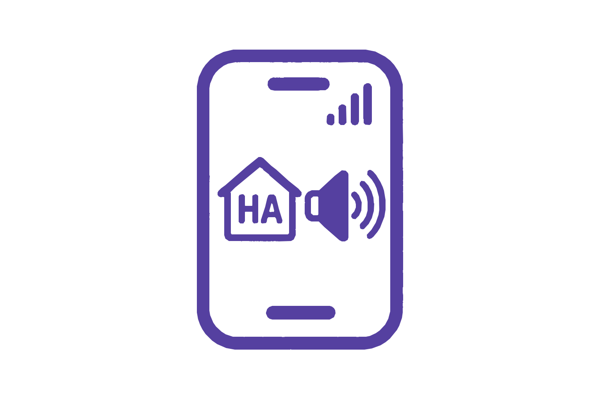

<p align="center">
  
</p>

# HAMediaConnect

Turn an Android phone or tablet into a native Home Assistant media player. Play music and other audio, control playback and volume, and send Home Assistant TTS announcements to the device. Music Assistant can use the player through Home Assistant's Media Players provider.

HAMediaConnect includes an Android app and a Home Assistant custom integration. Both are required.

## Install Home Assistant integration

### With HACS

Once HAMediaConnect is available in the HACS default catalog, find it under **HACS → Integrations** and download it. Until then, add it as a custom repository:

1. In Home Assistant, open **HACS → ⋮ → Custom repositories**.
2. Enter `https://github.com/emarrero-personal/HAMediaConnect` and select **Integration**.
3. Add the repository, find **HAMediaConnect** in HACS, and choose **Download**.
4. Restart Home Assistant.
5. Go to **Settings → Devices & services → Add integration**, search for **HAMediaConnect**, and complete setup.

### Manual installation

1. Download the source archive for the [latest release](https://github.com/emarrero-personal/HAMediaConnect/releases/latest) or clone the repository.
2. Copy `custom_components/hamediaconnect/` into `/config/custom_components/hamediaconnect/` on your Home Assistant installation. Keep the directory name `hamediaconnect` and copy the whole folder, including `brand/`.
3. Restart Home Assistant.
4. Add **HAMediaConnect** from **Settings → Devices & services → Add integration**.

## Install Android app

Download the signed APK from the [latest GitHub Release](https://github.com/emarrero-personal/HAMediaConnect/releases/latest):

- [Download HAMediaConnect.apk](https://github.com/emarrero-personal/HAMediaConnect/releases/latest/download/HAMediaConnect.apk)
- [Download its SHA-256 checksum](https://github.com/emarrero-personal/HAMediaConnect/releases/latest/download/HAMediaConnect.apk.sha256)

On an Android 10 or newer phone or tablet, open the downloaded APK and follow Android's installer prompts. If Android asks, allow your browser or file manager to install apps from that source. Disable that permission again after installation if you do not need it.

Only install APKs from this project's GitHub Releases. GitHub Actions debug APKs are for testing and are not the signed distribution build.

## Connect and enroll a device

1. Open HAMediaConnect and enter your Home Assistant base URL, such as `https://example.ui.nabu.casa` or `http://homeassistant.local:8123`.
2. Leave **Allow insecure HTTP connections** off when Home Assistant is available over HTTPS. To use HTTP for Home Assistant control, enable the setting explicitly and review its warning. HTTPS/WSS always works; HTTP media playback, including local TTS audio, is independent of this setting.
3. Sign in with OAuth on an HTTPS Home Assistant URL, or use a Home Assistant long-lived access token on a trusted local network if needed. OAuth is HTTPS-only. Do not send an HTTP token connection over an untrusted network or the public internet.
4. Save the connection and keep the app running until it reports **Connected**. On first connection, Android creates an installation-specific key in Android Keystore and proves possession to Home Assistant. The key is not uploaded. The integration then creates the device's `media_player` entity.

Version 0.10.0 introduced a new device authentication protocol. Version 1.0.0 updates the project branding and version while retaining that protocol. Keep the Android app and Home Assistant integration on matching versions; update both sides together and sign in again after the 0.10.0 protocol upgrade. Existing UUID-only registrations cannot be reused. Keep the app's device key intact for reconnects. If that key is lost or invalidated, use the integration's administrator revocation process before resetting the Android device identity; resetting creates a new Home Assistant player identity. See the [security and re-registration guide](docs/SECURITY_PHASE_2.md).

### Remove a device

To remove a phone or tablet and its `media_player` entity, open **Settings → Devices & services → HAMediaConnect**, select the device, and choose **⋮ → Delete**. Delete works only while the device is disconnected. If it is still connected, Home Assistant shows an error. Before deleting, use **Forget Home Assistant credentials** in the app's Settings, uninstall the app, or revoke the device.

Deleting does not block the device. If the same app connects again with its original key, it enrolls again and gets a new entity. To permanently block a device key, revoke it first (see the [security guide](docs/SECURITY_PHASE_2.md#persistence-revocation-key-loss)), then delete it. A revoked device keeps its block after you delete it. After a Home Assistant restart, a revoked device's leftover entity shows as no longer provided, and you can delete it from the entity's settings.

## Play audio, TTS, and Music Assistant

After the app connects, find its `media_player` entity in Home Assistant. For a direct audio URL, use **Media player → Play media** or an action such as:

```yaml
action: media_player.play_media
target:
  entity_id: media_player.your_android_device
data:
  media_content_type: music
  media_content_id: https://example.com/audio.mp3
```

Replace the example entity and URL with your own. The URL must be reachable from the Android device. Home Assistant media-source content and generated TTS are resolved by the integration; local HTTP media remains available even when HTTP control is disabled.

To send speech, use your configured Home Assistant text-to-speech provider's **Speak** action and select the HAMediaConnect player as the media player target.

To use Music Assistant, open **Music Assistant → Settings → Player Providers**, add or open **Home Assistant Media Players**, select the HAMediaConnect entity, and save. Music Assistant does not automatically expose every Home Assistant player.

## Updating

Update HAMediaConnect in HACS (or replace the integration directory with the new release), restart Home Assistant, then install the matching signed Android APK from the release page. Keep both sides updated together, especially when a release documents a device protocol change. Back up your current installation before manual file replacement.

## Troubleshooting

- **No HAMediaConnect integration in Add integration:** Confirm the integration is installed under `custom_components/hamediaconnect/`, restart Home Assistant, then refresh the browser.
- **No media player entity:** Check that the integration finished setup and the Android app reports **Connected**. Review Home Assistant logs and the app's connection status.
- **Device registration or reauthentication fails after upgrading:** Update both components to compatible versions, sign in again, and keep the original Android device key. If the key was lost, an administrator must revoke its old registration before the app identity is reset.
- **HTTP connection is refused:** Enable **Allow insecure HTTP connections** in Android Settings only if your Home Assistant URL is HTTP. HTTPS/WSS does not require this setting.
- **No sound or TTS:** Check Android media volume and mute. For TTS, read the player's `delivery_phase`, `delivery_reason` and `delivery_method` attributes. `received`/`retrieving` followed by `failed` means the command arrived but the audio did not; `playing` then `completed` means the device played it. For non-TTS media, confirm the media URL is reachable from the phone. See [TTS delivery troubleshooting](docs/diagnostics/TTS_DELIVERY.md#troubleshooting-connection-retrieval-or-playback).
- **Player missing from Music Assistant:** Select the entity in Music Assistant's **Home Assistant Media Players** provider settings.

## Documentation

- [Home Assistant integration installation notes](docs/HA_INTEGRATION_INSTALL.md)
- [Developer guide](docs/DEVELOPERS.md)
- [Phase 2 authentication and transport design](docs/SECURITY_PHASE_2.md)
- [HACS submission readiness and checklist](docs/HACS_SUBMISSION.md)
- [Third-party licenses and attribution](THIRD_PARTY_NOTICES.md)

## License

HAMediaConnect source code is licensed under **GNU GPL version 3 or any later version** (`GPL-3.0-or-later`). See [LICENSE](LICENSE). Third-party dependencies retain their own license terms; see [THIRD_PARTY_NOTICES.md](THIRD_PARTY_NOTICES.md). The approved project icon source is maintained in [branding/HAMediaConnect.svg](branding/HAMediaConnect.svg); generated Android and Home Assistant assets are derivatives of that artwork.

## Local and remote media delivery

On Android 17 or newer, grant **Local network** access when connecting the app.
If denied, enable it in Android's app permissions before using LAN media or LAN
Home Assistant control. Chrome has separate permissions; a working browser GET
does not prove the app can load the same audio.

Home Assistant TTS doesn't need a phone-reachable media URL. When the app and
integration are both this version, the integration renders the speech and the app
downloads it over its existing authenticated connection. Announcements therefore
work wherever the app shows **Connected**, including on cellular, and an in-progress
download resumes after a Wi-Fi/cellular switch. The rest of this section applies to
music and other non-TTS media, and to TTS with older app versions.

For playback away from home, enable Home Assistant Cloud remote access or configure
a valid external **HTTPS** URL in Home Assistant's network settings. Configure the
app's Home Assistant connection with that reachable HTTPS origin and authenticate
there once. Use this same origin on Wi-Fi and cellular. The integration prefers
HA's Cloud HTTPS endpoint when available, then a configured external HTTPS endpoint for HA-owned media, including TTS. It keeps local
media when no external HTTPS endpoint is configured. A local-only HTTP connection
cannot reconnect from cellular; do not expose port 8123 publicly.

The external endpoint must serve the actual `/api/tts_proxy/` and other media
paths. Reverse-proxy login pages, extra proxy authentication, disabled Cloud
remote access, expired media, or missing media routes can prevent playback even
when the WebSocket connects. The Android app reports sanitized playback errors in
its status and `HARemotePlayback` logs, and stops continuous buffering after
30 seconds. Regenerate expired TTS after restoring connectivity. Media redirects
are allowed only within the same origin, up to five hops. Cross-origin redirects
and HTTPS downgrades are refused; use a direct audio endpoint in those cases.
When an announcement fails and music is restored, Home Assistant receives the
restored music state and, separately, the announcement's `failed` delivery report with
a sanitized reason (see the player's `delivery_*` attributes and `hamediaconnect_playback` events).

See [TTS delivery](docs/diagnostics/TTS_DELIVERY.md) for the current architecture and
physical acceptance tests, and the earlier [TTS investigation](docs/diagnostics/TTS_PLAYBACK.md)
for the history.

For the v1.0.1 corrections, sanitized Playback diagnostics, and the pending Pixel 10
acceptance checklist, see [device corrections](docs/diagnostics/V1_0_1_FINAL_CORRECTIONS.md).

Network changes retry immediately with the saved credentials and device key.
Temporary transport, server and subscription failures back off automatically; confirmed
authentication failures require correcting the credentials or registration in Settings,
then Save and Connect. Idle Playback shows whether it is waiting for a connection;
currently playing audio and playback failures remain visible during reconnection.
