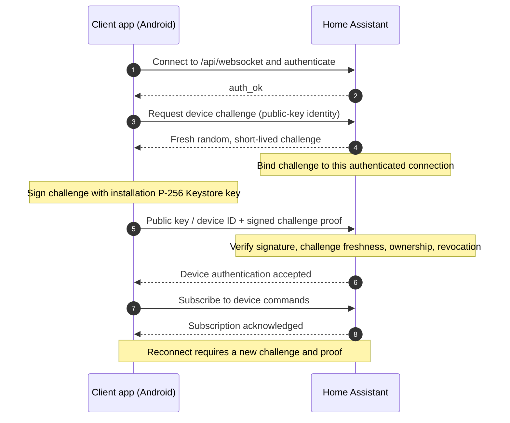

# HAMediaConnect — Developer Guide
This document describes the implementation and wire protocol

## Architecture

```text
Home Assistant automation / media_player / TTS
                 |
                 v
custom_components/hamediaconnect/
  media_player.py → registry.py → websocket_api.py
                 |
       Home Assistant WebSocket
         /api/websocket (WS/WSS)
                 |
                 v
Android ConnectionService
  HaOAuth + SecureTokenStore + DeviceIdentity
  HaWebSocketClient (challenge, proof, subscribe, state)
                 |
                 v
Android PlaybackService (Media3 ExoPlayer + MediaSession)
                 |
             Device audio
                 |
          PlayerStateBus
                 |
           ConnectionService → Home Assistant state
```

The companion integration provides the Home Assistant `media_player` entity and resolves `media-source://` URLs. The current Android client app manages connectivity, decoding incoming commands, playback and state reporting. The Android package and integration domain still use historical names for compatibility.

### Android code map

| File | Responsibility |
| --- | --- |
| `MainActivity.kt` | Dashboard, Settings, Help, OAuth callback and connection controls |
| `AppPrefs.kt` | Non-secret settings and device fingerprint display |
| `SecureTokenStore.kt` | Android encrypted credential storage |
| `HaOAuth.kt` | OAuth authorization-code flow with PKCE and refresh |
| `ConnectionService.kt` | Foreground WebSocket connection, reconnect, command routing |
| `ConnectionState.kt` | Typed connection failures, stages and retry policy |
| `MediaRedirectPolicy.kt` | Bounded same-origin media redirects |
| `HaWebSocketClient.kt` | Native Home Assistant WebSocket protocol |
| `HaCommand.kt` | Parsed command model |
| `PlaybackService.kt` | Media3 playback, announcements, volume, mute and DND |
| `PlayerStateBus.kt` | In-process playback state updates |
| `BootReceiver.kt` | Optional reconnect after reboot |

### Home Assistant code map

| File | Responsibility |
| --- | --- |
| `__init__.py` | Registers custom WebSocket API and config entry |
| `config_flow.py` | Integration setup |
| `media_player.py` | Home Assistant entity and media actions |
| `registry.py` | Connected-device registry and command dispatch |
| `websocket_api.py` | WebSocket registration, subscriptions and state messages |
| `oauth_view.py` | OAuth support endpoint |

## Authentication and connection

### Device authentication sequence

The device fingerprint is derived from a canonical encoding of the installation's public key; it is an identifier, **not** a secret. Authentication relies on a fresh challenge signed by the Android Keystore private key. No salt is needed for the public-key fingerprint.



Security requirements: challenges must be unpredictable, one-time-use, and time-limited; verification must bind the proof to the requesting connection and the authorized Home Assistant user. SHA-256 of the public key is a stable identifier, not an authentication substitute. See [security architecture](SECURITY_PHASE_2.md) for the authoritative protocol and limits.


The client app connects to the instance's `/api/websocket` endpoint, using `wss://` for HTTPS and `ws://` for HTTP. It waits for `auth_required`, then sends:

```json
{"type":"auth","access_token":"REDACTED"}
```

OAuth is recommended for HTTPS deployments; long-lived access tokens are supported for trusted local HTTP networks. Never print credentials in logs or include them in bug reports.

After `auth_ok`, the client app requests a P-256 challenge, signs it with its installation Keystore key, and authenticates that exact connection before subscribing. The device ID is the SHA-256 fingerprint of its public key. Reconnect always requires a fresh proof; HA user authentication alone cannot claim a registered device, including another installation belonging to the same HA user.

See [Phase 2 authentication and transport design](SECURITY_PHASE_2.md) for the complete message flow, strict schemas, limits, persistence, revocation/re-registration, MediaSession authorization, OAuth decisions, and remaining risks. Update the integration and client app together: the UUID-only registration protocol is no longer supported.

## Commands sent to the client app

The **native** interface uses the companion integration. These are command event payloads dispatched through the custom WebSocket subscription (not direct Home Assistant `fire_event` calls).

| `action` | Additional fields | Behavior |
| --- | --- | --- |
| `play_media` | `media_content_id` (absolute audio URL), optional `media_content_type`, `media_title`, `announce` | Load and play audio |
| `play` | none | Resume |
| `pause` | none | Pause |
| `stop` | none | Stop and clear playback |
| `volume_set` | `volume_level` number 0.0–1.0 | Set Android music stream volume |
| `volume_mute` | `is_volume_muted` boolean | Mute/unmute the app's ExoPlayer, not other Android apps |

Example command event data:

```json
{"action":"play_media","media_content_id":"https://example.com/audio.mp3","media_content_type":"music","media_title":"Sample","announce":false}
```

```json
{"action":"volume_set","volume_level":0.35}
```

```json
{"action":"volume_mute","is_volume_muted":true}
```

**Important:** `PlaybackService` contains a `seek` intent action, but the native WebSocket command decoder currently **does not expose seek**. Do not advertise it as a working remote command until implemented end-to-end. The legacy event-based protocol is not supported.

## Commands from Home Assistant

For normal users and automations, prefer the Home Assistant service/action API instead of sending native WebSocket messages:

```yaml
action: media_player.play_media
target:
  entity_id: media_player.your_android_device
data:
  media_content_type: music
  media_content_id: https://example.com/audio.mp3
```

```yaml
action: media_player.volume_set
target:
  entity_id: media_player.your_android_device
data:
  volume_level: 0.35
```

```yaml
action: media_player.volume_mute
target:
  entity_id: media_player.your_android_device
data:
  is_volume_muted: true
```

Supported Home Assistant entity features currently include PLAY, PAUSE, STOP, PLAY_MEDIA, VOLUME_SET and VOLUME_MUTE.

## State reporting

The client app sends a native WebSocket state message resembling:

```json
{
  "id":3,
  "type":"hamediaconnect/state",
  "device_id":"64_HEX_PUBLIC_KEY_FINGERPRINT",
  "state":{
    "state":"playing",
    "volume_level":0.35,
    "is_volume_muted":false,
    "media_title":"Sample",
    "media_content_id":"https://example.com/audio.mp3"
  }
}
```

The `state` object may omit media metadata when unavailable. Supported playback states include `idle`, `buffering`, `playing` and `paused`; the current Android client implementation normalizes `error` to `idle` before publishing.

## Announcements, audio focus and DND

When the companion integration receives a TTS media-source URL (`media-source://tts/...`), it resolves it to a playable URL and sets `announce=true`. For an announcement, the current Android client player saves its own current media item, playback position and playing/paused status, then restores them when the announcement finishes. Audio from another Android app is not directly controlled by this playback service.

The app suppresses announcements when Android's interruption filter indicates Do Not Disturb. If DND activates during an announcement, the service ends it and restores previously interrupted playback. This behavior should be tested on target devices because Android audio policy and OEM behavior vary.

For maintainer build, test, signing, and release instructions, see [Maintainer handbook](MAINTAINER.md).

## Media endpoint selection and diagnostics

HA signs/resolves media through its standard media helpers, identifies HA-owned
origins with `is_hass_url`, and prefers Cloud HTTPS, then configured external HTTPS, via `get_url`.
The Android client keeps public absolute URLs and resolves relative paths using
its configured control origin. Production Media3 loading uses a separate OkHttp
client, validates TLS, allows only bounded same-origin redirects and bounds buffering. Announcement errors
are recorded before restoring prior playback. There are no new command/state
fields. See the [TTS investigation](diagnostics/TTS_PLAYBACK.md) for the historical trace. See [v1.0.1 device corrections](diagnostics/V1_0_1_FINAL_CORRECTIONS.md) for the current live UI, reconnect error classification, security review and physical acceptance procedure.


Default-network changes cancel old generations and retry immediately. Subsequent
recoverable failures use bounded equal-jitter backoff indefinitely. The connection
service consumes `ConnectionEvent`/`ConnectionFailure`, persists a typed phase for
live UI rendering, and never parses display text to decide retry or authorization.
A manual corrected-configuration action resets a terminal block; network events do not.
HA resource ownership is established before default URL conversion so an unrecognized
LAN origin cannot suppress Cloud/external HTTPS selection. See the current device
corrections for the failure-code matrix, tests and physical acceptance checklist.
