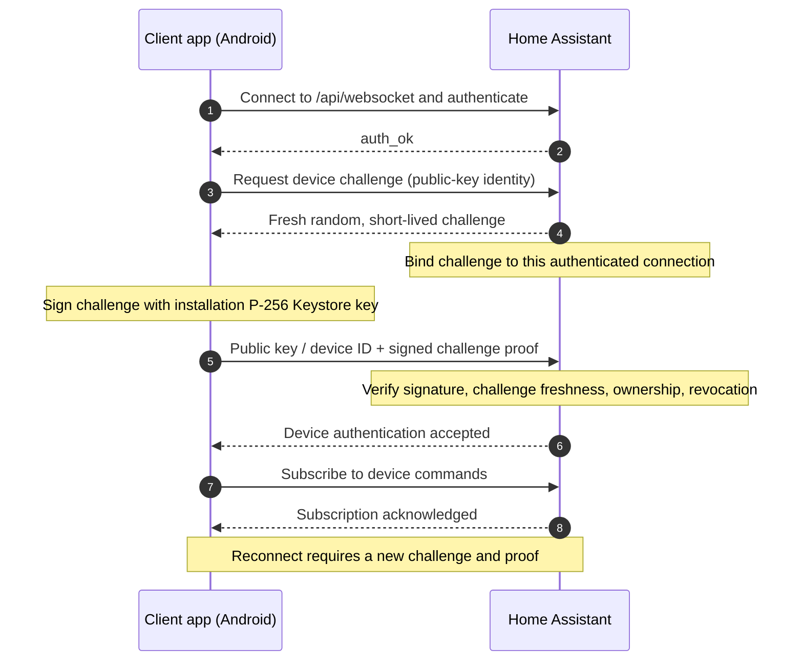

# HAMediaConnect — Developer Guide
Here’s how the app and integration fit together, where to find the code, and what they send over the WebSocket.

## Architecture

```text
Home Assistant automation / media_player / TTS
                 |
                 v
custom_components/hamediaconnect/
  media_player.py → registry.py → websocket_api.py
                 |
       Home Assistant WebSocket
         /api/websocket (WS/WSS)
                 |
                 v
Android ConnectionService
  HaOAuth + SecureTokenStore + DeviceIdentity
  HaWebSocketClient (challenge, proof, subscribe, state)
                 |
                 v
Android PlaybackService (Media3 ExoPlayer + MediaSession)
                 |
             Device audio
                 |
          PlayerStateBus
                 |
           ConnectionService → Home Assistant state
```

The companion integration provides the Home Assistant `media_player` entity and resolves `media-source://` URLs. The Android client app keeps the connection open, reads incoming commands, plays audio, and reports playback state. The Android package and integration domain still use historical names for compatibility.

### Android code map

| File | Responsibility |
| --- | --- |
| `MainActivity.kt` | Dashboard, Settings, Help, OAuth callback and connection controls |
| `AppPrefs.kt` | Non-secret settings and device fingerprint display |
| `SecureTokenStore.kt` | Android encrypted credential storage |
| `HaOAuth.kt` | OAuth authorization-code flow with PKCE and refresh |
| `ConnectionService.kt` | Foreground WebSocket connection, reconnect, command routing |
| `ConnectionState.kt` | Typed connection failures, stages and retry policy |
| `MediaRedirectPolicy.kt` | Media redirects: up to five hops within the same origin |
| `MediaTransfer.kt` | TTS over WebSocket: check offers, download chunks, resume, verify audio, manage temporary files |
| `DeliveryStatus.kt` | Delivery status enums, latest-request tracking, and UI labels that leave out sensitive details |
| `HaWebSocketClient.kt` | Native Home Assistant WebSocket protocol |
| `HaCommand.kt` | Parsed command model |
| `PlaybackService.kt` | Media3 playback, announcements, volume, mute and DND |
| `PlayerStateBus.kt` | In-process playback state updates |
| `BootReceiver.kt` | Optional reconnect after reboot |
| `BackgroundAudio.kt` | Android 17 audio activation; lasts for the process, and needs user interaction after boot |

### Home Assistant code map

| File | Responsibility |
| --- | --- |
| `__init__.py` | Registers custom WebSocket API and config entry |
| `config_flow.py` | Integration setup |
| `media_player.py` | Home Assistant entity and media actions |
| `button.py` | Per-device sonar button using the existing authenticated audio transfer |
| `registry.py` | Tracks devices, sends commands supported by each client, and handles delivery reports |
| `transfer.py` | Stores TTS audio generated inside HA, limits memory use, and serves chunks only to the intended device |
| `websocket_api.py` | WebSocket registration, subscriptions and state messages |
| `oauth_view.py` | OAuth support endpoint |

## Authentication and connection

### Device authentication sequence

The device fingerprint is the SHA-256 hash of the installation’s public key in DER SubjectPublicKeyInfo format. It identifies the device; it isn’t a secret. Authentication relies on a fresh challenge signed by the Android Keystore private key. No salt is needed for the public-key fingerprint.



Each challenge must be random, usable only once, and have an expiry time. HA must check that the signed response belongs to the connection and user that requested it. SHA-256 of the public key is a stable identifier, not an authentication substitute. See [security architecture](SECURITY_PHASE_2.md) for the full protocol and limits.


The client app connects to the instance's `/api/websocket` endpoint, using HTTPS/WSS only. HTTP/WS control is rejected before credentials are read or a socket is opened. It waits for `auth_required`, then sends:

```json
{"type":"auth","access_token":"REDACTED"}
```

OAuth is recommended; long-lived access tokens also require HTTPS. HTTP audio URLs remain supported through the separate media client. Never print credentials in logs or include them in bug reports.

After `auth_ok`, the client app requests a P-256 challenge, signs it with its installation Keystore key, and authenticates that exact connection before subscribing. The device ID is the SHA-256 fingerprint of its public key. Reconnect always requires a fresh proof; HA user authentication alone cannot claim a registered device, including another installation belonging to the same HA user.

See [Authentication, registration, and transport security](SECURITY_PHASE_2.md) for the complete message flow, strict schemas, limits, persistence, revocation/re-registration, MediaSession authorization, OAuth decisions, and remaining risks. Update the integration and client app together: the UUID-only registration protocol is no longer supported.

## Commands sent to the client app

The integration sends these commands as events on the device’s WebSocket subscription. To control playback, use the media-player actions shown below; these messages aren’t HA `fire_event` calls.

| `action` | Additional fields | Behavior |
| --- | --- | --- |
| `play_media` | Either `media_content_id` (absolute audio URL) **or** an in-band transfer offer (`transfer_id`, `media_size`, `media_sha256`, `chunk_size`, audio `media_content_type`); optional `media_content_type`, `media_title`, `announce`, `request_id` | Load and play audio |
| `play` | none | Resume |
| `pause` | none | Pause |
| `stop` | none | Stop and clear playback |
| `volume_set` | `volume_level` number 0.0–1.0 | Set Android music stream volume |
| `volume_mute` | `is_volume_muted` boolean | Mute/unmute the app's ExoPlayer, not other Android apps |

Example command event data:

```json
{"action":"play_media","media_content_id":"https://example.com/audio.mp3","media_content_type":"music","media_title":"Sample","announce":false}
```

```json
{"action":"volume_set","volume_level":0.35}
```

```json
{"action":"volume_mute","is_volume_muted":true}
```

Transfer offers and `request_id` are sent only to clients that negotiated
`media_transfer_v1` / `playback_report_v1` when subscribing; see
[in-band TTS transfer security](SECURITY_PHASE_2.md#in-band-tts-transfer) for
how HA restricts audio chunks and playback reports to the right device.

**Important:** `PlaybackService` contains a `seek` intent action, but the native WebSocket command decoder currently **does not expose seek**. Do not advertise it as a working remote command until implemented end-to-end. The legacy event-based protocol is not supported.

## Commands from Home Assistant

For normal users and automations, prefer the Home Assistant service/action API instead of sending native WebSocket messages:

```yaml
action: media_player.play_media
target:
  entity_id: media_player.your_android_device
data:
  media_content_type: music
  media_content_id: https://example.com/audio.mp3
```

```yaml
action: media_player.volume_set
target:
  entity_id: media_player.your_android_device
data:
  volume_level: 0.35
```

```yaml
action: media_player.volume_mute
target:
  entity_id: media_player.your_android_device
data:
  is_volume_muted: true
```

Supported Home Assistant entity features currently include PLAY, PAUSE, STOP, PLAY_MEDIA, VOLUME_SET and VOLUME_MUTE.

## State reporting

The client app reports state over the WebSocket like this:

```json
{
  "id":3,
  "type":"hamediaconnect/state",
  "device_id":"64_HEX_PUBLIC_KEY_FINGERPRINT",
  "state":{
    "state":"playing",
    "volume_level":0.35,
    "is_volume_muted":false,
    "media_title":"Sample",
    "media_content_id":"https://example.com/audio.mp3"
  }
}
```

The `state` object leaves out media metadata when it isn’t available. Playback states include `idle`, `buffering`, `playing`, and `paused`. The Android client reports `error` as `idle`.

The app reports progress for each playback request separately with
`hamediaconnect/playback_report` (phase plus an enum reason). HA exposes the last report
as `delivery_phase`, `delivery_reason`, `delivery_method` and `delivery_request_id`
entity attributes and fires `hamediaconnect_playback` events. State `media_content_id`
is omitted while playing transferred audio.

## Announcements, audio focus and DND

When the companion integration receives a TTS media-source URL (`media-source://tts/...`), it resolves it to a playable URL and sets `announce=true`. For an announcement, the current Android client player saves its own current media item, playback position and playing/paused status, then restores them when the announcement finishes. Audio from another Android app is not directly controlled by this playback service.

The app skips announcements while Android’s Do Not Disturb setting is active. If DND activates during an announcement, the service ends it and restores previously interrupted playback. Test this on the devices you plan to support: Android audio rules and manufacturer behavior vary.

For maintainer build, test, signing, and release instructions, see [Maintainer handbook](MAINTAINER.md).

## TTS delivery

HA-generated TTS (`media-source://tts/...`) is rendered in-process with
`tts.async_get_media_source_audio` and pulled by the device in 48 KiB chunks over the
already-authenticated WebSocket. No media URL has to be reachable from the phone, so
announcements behave the same on Wi-Fi and cellular and resume across network changes.
HA selects one delivery method per command. URL delivery (below) remains for all other
media, for legacy clients, and when in-process rendering is unavailable or the audio
exceeds 4 MiB. See [in-band TTS transfer security](SECURITY_PHASE_2.md#in-band-tts-transfer)
for authorization and integrity checks, [transport limits](SECURITY_PHASE_2.md#transport-limits)
for size and request limits, and the [maintainer checklist](MAINTAINER.md#development-and-test-checklist)
for device validation.

## Sonar identification button

The `button` platform creates a translated **identify** entity for each saved
or newly registered device that hasn’t been revoked, using the same device-registry identifiers as
the media player. Its unique ID adds `_sonar_ping` to the media player's unique ID.
Registration/state events keep availability current, and entity removal permits
re-enrollment without duplicate entities. A live subscription must have negotiated
`media_transfer_v1`; older clients keep their existing media player behavior and
the button remains unavailable until they update.

Pressing the button reads only `media/SamsterBirdies-Sonar-Ping.mp3` on a worker thread,
using the same 4 MiB transfer limit as TTS. After the read finishes, HA checks again
that the device is connected, hasn’t been revoked, and supports audio transfers. The existing transfer store and `registry.dispatch` deliver it as
an announcement, with a delivery request ID only when `playback_report_v1` was
negotiated. Failed sends release only their own transfer. Playback, DND, mute, and
music restoration use the client's existing announcement path. There is no new
HTTP route, runtime external download, or device protocol command.

## Media endpoint selection and diagnostics

HA signs/resolves media through its standard media helpers, identifies HA-owned
origins with `is_hass_url`, and prefers Cloud HTTPS, then configured external HTTPS, via `get_url`.
The Android client keeps public absolute URLs and resolves relative paths using
its configured control origin. Production Media3 loading uses a separate OkHttp
client, validates TLS, follows at most five redirects within the same origin, and
stops continuous buffering after 30 seconds. It records announcement errors before
restoring the interrupted playback. There are no new command/state
fields. See [media delivery and provenance](SECURITY_PHASE_2.md#media-delivery-and-provenance)
for security controls and the [maintainer checklist](MAINTAINER.md#development-and-test-checklist)
for device validation.


When the default network changes, the service cancels the old connection attempt
and retries immediately. If that fails, it keeps retrying with randomized delays
that grow up to 150–300 seconds. The service uses `ConnectionEvent` and
`ConnectionFailure` enums to decide what to do and save status for the UI; it never
makes retry or authorization decisions by reading display text. Errors that need
user attention stay blocked until an explicit Settings connection action; network
changes don’t clear them. HA checks whether it owns a media resource before
converting its URL, so a LAN address it doesn’t recognize won’t prevent selection
of Cloud or external HTTPS. See
[reconnect and failure recovery](SECURITY_PHASE_2.md#reconnect-and-failure-recovery)
for failure classification and retry behavior.
