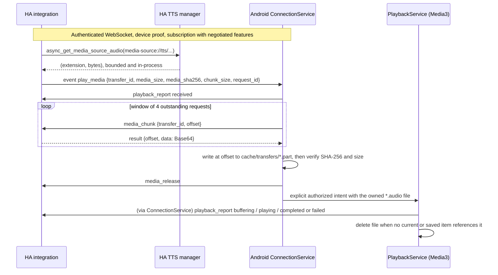

# Reliable remote TTS delivery

Status: implemented on `fix/v1.0.1-device-corrections`. Automated tests pass (see
[Validation](#validation)). **Not yet verified against a live Nabu Casa tunnel or
on a physical phone over cellular.** Run the [physical acceptance tests](#physical-acceptance-tests)
before release.

## Root cause

Before this change, every announcement depended on the phone fetching an HTTP URL
from Home Assistant. HA's TTS media source resolves to a relative, unauthenticated
capability URL: `ResultStream.url` returns `/api/tts_proxy/<token>`. The token is
`secrets.token_urlsafe(16)` plus an extension, and `TextToSpeechView` has
`requires_auth = False`. The integration had to turn that path into an absolute URL
that the phone could reach:

1. **The original defect:** `async_process_play_media_url()` falls back to HA's
   default `get_url()` order outside an HTTP request context. That order prefers the
   internal URL, which produced the recorded `HTTP · Local · /api/tts_proxy/[redacted]`.
   On cellular the WebSocket (configured with the Cloud origin) still connected, but
   the private-LAN media URL was unreachable.
2. **The branch's first correction** (`prefer_cloud=True`, then external HTTPS) is
   correct but conditional. `_get_cloud_url()` returns a URL only while Cloud Remote
   UI is enabled and connected (`async_remote_ui_url` raises `CloudNotAvailable`
   otherwise). Without Remote UI or an external HTTPS URL, HA still sends the LAN
   URL. The phone then waits for a 10-second connect timeout, or for the 30-second
   buffering watchdog. Even with Remote UI, URL selection proves nothing about the
   phone's path to that host (DNS, carrier filtering, proxy login pages, or token
   expiry after HA's 300-second memory-cache `DictCleaning` age).

The underlying problem: **the only channel proven reachable when a command arrives
is the authenticated WebSocket that delivered the command.** A media URL is a second,
independently failing network path.

## Options evaluated

Evidence comes from the HA core source (2025.1.4 and 2026.2.3 wheels inspected), not
from documentation alone.

| Option | Verdict | Evidence and reasoning |
| --- | --- | --- |
| **A. Nabu Casa / external HTTPS URL** | Kept for non-TTS media and legacy clients; not relied on for HA TTS | Remote UI tunnels all HTTP paths, including `/api/tts_proxy/`, so it *can* work. It needs Remote UI enabled and connected, a phone that can resolve and reach `*.ui.nabu.casa`, and a token that hasn't expired. A failure is detected only after a connect or read timeout, which delays the announcement on exactly the path being fixed. |
| **B. Push audio over the WebSocket** | Rejected in push form | HA's writer sends only TEXT frames (`send_bytes_text = partial(writer.send_frame, opcode=WSMsgType.TEXT)`). Binary output isn't part of the protocol, so the payload must be Base64 in JSON. Unsolicited pushing has no flow control: HA closes connections whose queue exceeds `MAX_PENDING_MSG` (4096) or stays above `PENDING_MSG_PEAK` (1024) for 10 seconds, and its error log then includes the last queued message, which here would be Base64 audio. |
| **C. Pull-based in-band transfer** *(chosen for HA TTS)* | Implemented | The device requests bounded chunks over the same authenticated WebSocket using normal command/result messages. Request/response gives natural backpressure, ordering by offset, and resumption on a new connection. Audio is rendered in-process with HA's public `tts.async_get_media_source_audio()`, which the voip, ESPHome, and Wyoming integrations also use. No URL is generated, fetched, or sent. |
| C'. Custom authenticated HTTP endpoint or short-lived media token | Rejected | It still needs a second reachable HTTP path, so it inherits option A's failure mode. It would also add a new unauthenticated or bearer-capability surface. |
| C''. Hybrid: HTTPS first, then direct fallback on the device | Rejected | Fallback starts only after the URL fails (connect/read timeouts of 10 s, buffering watchdog of 30 s), which adds delay on cellular. It also creates a window where a late URL success and a fallback could both play. Under option C, HA picks exactly one method before sending, so a duplicate can't happen by construction. |

## Chosen architecture

Delivery selection is decided by HA, once per command, in `AndroidMediaPlayer.async_play_media`:

1. `media-source://tts/...` **and** the device negotiated `media_transfer_v1` → render
   in-process (30-second timeout) and send a transfer offer. No URL is resolved.
2. Rendering fails, the format isn't `audio/*`, the audio exceeds 4 MiB, or transfer
   capacity is exhausted → the existing URL path (Cloud → external HTTPS → default)
   is used. The media ID, which contains the spoken message, is never logged.
3. Everything else (music, signed media-source files, public URLs, legacy apps) →
   the existing URL path, unchanged.

### Compatibility and negotiation

- `register` results add `"features": ["media_transfer_v1", "playback_report_v1"]`.
  Older apps only read `device_id`, so they ignore the new key.
- New apps send `features` in `subscribe_commands` **only if** the server advertised
  them. An old integration, which rejects extra subscribe fields, never sees them.
- Features belong to the live command subscription and disappear with it. The
  registry refuses to dispatch `transfer_id` or `request_id` to a subscriber that
  didn't negotiate them, so a legacy app never receives fields it would reject.
- A malformed advertised feature list is a protocol error, consistent with every
  other malformed handshake message.

## Protocol

| Message | Direction | Fields | Notes |
| --- | --- | --- | --- |
| `play_media` event | HA → app | `transfer_id` (22 base64url chars), `media_size` (1–4 MiB), `media_sha256` (64 hex), `chunk_size` (exactly 49152), `media_content_type` (`audio/*`), `announce`, optional `media_title`, `request_id` | Exactly one of `media_content_id` or the full transfer group. `request_id` (16 base64url chars) also accompanies URL commands when reports were negotiated. |
| `hamediaconnect/media_chunk` | app → HA | `device_id`, `transfer_id`, `offset` | `offset` must be a non-negative multiple of 49152 that's less than the size. Result: `{"offset", "data"}` with standard padded Base64 of at most 65536 characters. |
| `hamediaconnect/media_release` | app → HA | `device_id`, `transfer_id` | Frees HA memory early. Best effort. |
| `hamediaconnect/playback_report` | app → HA | `device_id`, `request_id`, `phase`, optional `reason` | `phase` ∈ received, retrieving, buffering, ready, playing, completed, failed, suppressed. `reason` is a fixed enum (unreachable, dns, tls, timeout, access_denied, missing, server_error, redirect, content_type, decode, integrity, too_large, interrupted, superseded, stopped, dnd, unavailable, other). |

Transfer errors are scoped to the transfer: an unknown, expired, foreign, or
out-of-range transfer returns `media_unavailable`, rate limiting returns
`temporarily_unavailable`, and neither one changes connection authorization. A
rejected report is ignored. Malformed chunk results (wrong offset, extra keys,
invalid or oversized Base64) are protocol errors, like any other malformed server
message.

### Delivery states

Receiving a command is never treated as playback. `DeliveryTracker` keeps the
latest request, and only Media3 transitions in `PlaybackService` advance it past
`retrieving`:

| Phase | Source | Card text |
| --- | --- | --- |
| received | command parsed | Receiving announcement / Receiving media |
| retrieving | transfer started, or URL handed to Media3 | Downloading audio / Loading media / Reconnecting — audio transfer will resume |
| buffering | `STATE_BUFFERING` | Buffering |
| ready | `STATE_READY` before playback | Media ready |
| playing | `isPlaying` first becomes true | Playing |
| completed | `STATE_ENDED` after READY | Completed (and "Last delivery: Completed" when idle) |
| failed | transfer failure, Media3 error, buffering watchdog, Stop | Failed — *reason* |
| suppressed | DND, or Android 17 background audio not enabled | Suppressed — Do Not Disturb, or Enable background audio in HAMediaConnect |

Terminal phases are final for that request, and updates for any older request are
ignored. Each phase is reported to HA at most once per request. A phase that
happens while HA is unreachable is reported after reconnection. HA stores the last
report and exposes it as the entity attributes `delivery_phase`, `delivery_reason`,
`delivery_method` (`direct`/`url`), and `delivery_request_id`. Before the first
report arrives, `delivery_phase` is `dispatched`: HA sent the command, but the
device hasn't confirmed receiving it. It also fires a
`hamediaconnect_playback` event, which automations can use to tell real
announcement completion from command receipt.

## Security controls

- **No new HTTP surface.** There is no endpoint, token, or URL. Chunks are served
  only to a connection that has completed the device-key proof for the transfer's
  device (`registry.owned()`), and owner and revocation checks apply on every chunk.
  Another device of the same HA user gets `media_unavailable`, which is
  indistinguishable from a missing transfer. An unproven connection is rejected.
- **No SSRF or file fetch.** Audio comes only from HA's in-process TTS manager for a
  `media-source://tts/` ID handled by HA's own parser. The device can't name a URL,
  path, or arbitrary transfer, only offsets within a transfer HA offered to it.
- **Bounded resources.** HA side: 4 MiB per transfer, one per device (a newer
  announcement replaces it), 8 live transfers and 16 MiB total, 120-second expiry,
  600 chunk requests per user per minute, 240 reports per user per minute, plus the
  existing 2048 messages per minute and 16 KiB request limits. Android side: 4
  outstanding chunk requests, 16 outstanding auxiliary requests, a 90-second transfer
  deadline, and strict offer validation before any file is created.
- **Integrity.** Offsets and lengths are validated per chunk. After assembly, the file
  size and SHA-256 must match the offer before playback. Transport integrity comes
  from WSS/TLS; the digest guards against assembly and protocol defects, not against
  an attacker who controls HA.
- **Frame bound.** The general 16 KiB inbound bound still applies to every message,
  except a `result` whose `id` matches an outstanding chunk request. That result may
  be up to 132 KiB as raw text: the 64 KiB Base64 payload doubled, because JSON
  encoders may escape every `/` as `\/`, plus 1 KiB. Its decoded `data` string is
  still capped at 65536 characters, and the JSON depth limit of 8 still applies.
- **Storage.** Audio is written only to `cacheDir/transfers/` under the
  unpredictable transfer ID (`.part` while downloading, `.audio` when verified).
  `PlaybackService` accepts a file only when its canonical parent is that directory,
  its name matches that pattern, and it's a completed `.audio` file. The file is
  deleted after completion, failure, Stop, replacement, or service destruction.
  Orphans from process death are purged after 10 minutes. App data backup remains
  disabled, and cache is never backed up.
- **No sensitive logging or display.** The card shows "Direct transfer · Home
  Assistant connection". State updates for direct playback omit `media_content_id`,
  so no file path is published. HA logs only the entity ID when it falls back to
  URL delivery.
- **Unchanged:** device identity proof, owner binding, revocation, replay
  resistance, the permanent-failure block, OAuth/PKCE, the HTTP opt-in, the
  same-origin media redirect policy, and the credential-free media client.

## Failure and recovery behavior

| Situation | Behavior |
| --- | --- |
| Wi-Fi ↔ cellular during a transfer | The default-network callback closes the old socket and detaches the transfer, so its outstanding requests become `Disconnected` and late results from the old generation are ignored. The service then reconnects with a fresh proof and the transfer resumes at the missing offsets. No Settings action is needed. The HA transfer is bound to the device, not to the connection. |
| Temporary outage longer than 90 s | The transfer fails as `interrupted`, or `timeout` while connected. The next announcement works normally. |
| HA transfer expired (120 s) or replaced | `media_unavailable` → `failed/missing`. No retry, because the audio is gone. |
| Rate limited | `temporarily_unavailable` → re-request after 1 s, within the deadline. |
| Confirmed permanent rejection | The transfer is cancelled and the partial file deleted. The existing block still requires an explicit Settings action. |
| Newer command or Stop during a transfer | The transfer is cancelled (`superseded`/`stopped`). A result that completes afterward is discarded and its file deleted. |
| Repeated command with the same transfer or request ID | Ignored, both by the transfer controller and by `PlaybackService`. |
| DND | The announcement is suppressed (`suppressed/dnd`) and the transferred file deleted. Existing music restoration is unchanged. |
| URL path failure (non-TTS or fallback) | Classified as dns, tls, timeout, access_denied (401/403), missing (404/410), server_error (5xx), redirect, content_type, decode, or unreachable, and reported to HA. |

## Performance

- Rendering happens before the command is sent, so `tts.speak` returns after the
  audio is generated (HA caches it as usual). Streaming playback of partially
  generated audio over the URL path isn't used for HA TTS.
- One chunk carries 48 KiB of audio (64 KiB of Base64, a 33% overhead). With 4
  requests in flight, a typical 20–200 KB announcement needs 1–5 round trips. The
  4 MiB maximum needs 86 chunks.
- Peak memory: HA holds at most 16 MiB of transfers in total. Android holds one
  chunk string (at most 132 KiB) plus its decoded bytes at a time, and writes to disk.

## Troubleshooting: connection, retrieval, or playback?

Read the app's **Status** and **Playback** cards together with the entity attributes.

1. **Connection problem:** Status isn't `Connected`, the HA entity is unavailable,
   and no `delivery_*` attribute changes after `tts.speak`. Fix control connectivity
   first (Cloud origin, credentials, Local network permission). A transfer in
   progress shows "Reconnecting — audio transfer will resume".
2. **Command delivered, audio retrieval failed:** `delivery_phase` reaches
   `received`/`retrieving`, then `failed` with `missing`, `interrupted`, `timeout`,
   or `integrity` (direct), or `dns`/`tls`/`access_denied`/`missing`/`server_error`/
   `unreachable` (URL). `delivery_method` tells you which path HA chose. If it's
   `url` for TTS, the app or integration didn't negotiate `media_transfer_v1`
   (version mismatch), or HA couldn't render the audio in-process (check HA logs at
   debug level for "Direct TTS delivery unavailable").
3. **Audio retrieved, playback failed:** phases reach `buffering`/`ready` and then
   `failed/decode` or `failed/timeout`. Check the TTS format and engine.
4. **Played:** `playing` then `completed`. If nothing was audible, check Android
   media volume, the app's mute state, and Bluetooth routing. Older builds can
   report these phases even when Android 17 silently mutes background playback.
5. **Suppressed:** `suppressed/dnd` means Android Do Not Disturb blocked the
   announcement, as designed. `suppressed/unavailable` means the Android 17
   background-audio activation is missing. Tap **Enable audio** in the connection
   notification, or **Enable background audio** in the app, then retry the request.
   Audio is not queued for later playback.

### Android 17 background audio

The connection foreground service can be restored at boot without the while-in-use
capabilities Android 17 requires for audio. During the November 12 Pixel 10
investigation, `dumpsys audio` explicitly recorded `AudioHardening background
playback muted` with `level: full`; Home Assistant still received `playing` and
`completed`. Bringing the app to the foreground made the test audible.

Save & connect and Enable background audio start the persistent connection service
from the visible activity. The app keeps activation only in process memory and
clears it when the connection service stops or is recreated. Network reconnects
within that service retain activation. Boot and package-replacement reconnects do
not activate audio. The persistent notification offers **Enable audio** when
activation is required. Its immutable foreground-service PendingIntent re-promotes
the existing connection service in response to the user's tap, without replacing
the authenticated socket or clearing an authentication failure. The action is
removed once enabled. Playback rejects an unactivated request with the
existing `suppressed/unavailable` wire values and deletes its transferred file.
No protocol feature or new permission is required.

The playback service explicitly adds its session to Media3 because HA commands
start it directly without a controller connection. Media3 can then manage the
playback foreground notification. The separate user-started connection service
keeps the user-enabled receiver alive between announcements. DND and controller
authorization remain enforced. No silent keep-alive audio is played.

Physical acceptance: enable from the app, background it, lock the screen, then
test TTS and sonar after a long idle and a network reconnect. Check the connection
service has while-in-use capabilities and no new hardening-mute record appears.
After reboot or service recreation, verify the enable prompt, the suppressed
delivery report before activation, and successful background playback after
activation. Do not disable Android audio hardening to validate the fix.

See [Android's background-audio requirements](https://developer.android.com/about/versions/17/changes/bg-audio).

#### Pixel 10 validation — November 12, 2026

Tested the local 1.0.7 debug build on a physical Pixel 10 running Android 17
(API 37), paired with Babcock Home Assistant. Installed as an update using the
same debug certificate, retaining the existing credentials and device identity.

- Before activation, a direct TTS request ended with
  `delivery_phase: suppressed`, `delivery_reason: unavailable`.
- The user tapped **Enable background audio**, then locked the phone.
- Android reported the connection foreground service had while-in-use
  capabilities (`PROC_STATE_TOP` from its user-started lifecycle).
- At approximately 9:34 a.m. Eastern, a new direct TTS request completed while
  keyguard was showing and the screen was asleep. No new HAMediaConnect
  audio-hardening mute record appeared. The user confirmed hearing the speech.
- Left the phone untouched, locked and asleep for over 15 minutes (9:35–9:50 a.m.
  Eastern). The next direct TTS request completed, Android recorded no new
  hardening-mute event, and the user confirmed hearing it. USB/ADB remained
  connected; this does not establish deep-Doze or unplugged battery behavior.
- Rebooted the phone. After first unlock, Android delivered the boot receiver
  after a queue delay and the app reconnected automatically without opening its
  activity. The connection service lacked while-in-use capabilities (`DENIED`).
  A direct TTS request correctly reported `suppressed/unavailable`.
- The user enabled background audio again and locked the phone. The connection
  service then had while-in-use capabilities, the next direct TTS request
  completed with no new hardening-mute record, and the user confirmed hearing it.
- Updated the debug build with the notification action and separate playback
  notification ID. The user enabled audio from the connection notification and
  locked the phone. A direct TTS request completed, Android recorded no
  hardening-mute event, and the user confirmed hearing the speech.
- Final local validation passed: 126 Android unit/Robolectric tests, detekt,
  debug APK assembly, application coverage 97.45%, and security coverage 93.10%.

This confirms immediate and 15-minute-idle locked-screen TTS after user activation,
plus boot reconnection, suppression before reactivation, and audible locked-screen
TTS after reactivation. Network-transition, Bluetooth, DND, and music-resume acceptance
checks for this build remain outstanding. No release has been published.

The service dump during the idle retest also exposed a notification ID collision:
both services used 1001. Playback now uses 1002 so Media3's notification does not
replace the persistent connection notification. The subsequent notification-action
smoke test used this correction; the long-idle and reboot tests preceded it.

## Validation

Automated (local; see the device-corrections document for the full run record):

- Python: transfer store limits and expiry, offset validation, owner/device/
  unproven-connection isolation, reconnect with a real second challenge and
  signature, revocation cleanup, negotiation (legacy subscriber receives no new
  fields), reports bound to dispatched request IDs, rate-limit errors as retryable,
  in-process TTS selection without URL resolution, fallback to URL for each render
  failure without logging the message, and delivery attributes.
- Android JVM/Robolectric: the transfer engine (window, out-of-order and duplicate
  chunks, wrong length/offset/digest, expiry, retry, reconnect resume, deadline,
  supersession, cancellation, cleanup, offer bounds, file ownership); the client
  protocol (negotiation, malformed features, chunk frame bound and strict result
  validation, transfer-scoped errors, disconnect abandonment, report isolation,
  request bounds); `ConnectionService` orchestration (hand-off, network change
  mid-transfer without user action, duplicate suppression, permanent rejection,
  supersession by URL or Stop, missed-report replay); real Media3 playback of
  generated WAV audio from a transferred file (decode, playing, completed, deletion,
  music interruption and restoration, DND, duplicate request, corrupt audio and
  recovery, Stop); and URL delivery against a local HTTP fixture (real decode and
  completion; 401/403/404/410/500/503; DNS; TLS).
- Not automated: a live HA instance, real Cloud Remote UI, and physical cellular
  networks. The HA-side tests stub HA's module surface. The direct-transfer path
  calls `tts.async_get_media_source_audio`, which exists with the same signature in
  HA 2025.1.4 and 2026.2.3. On 2025.1, `-stream-` media-source IDs aren't accepted
  by that helper, and those fall back to URL delivery.

## Physical acceptance tests

Use the paired integration and APK from this branch on a test HA instance. Keep the
enrolled identity, and don't install over a differently signed APK. Record app and
integration versions, network, card text, entity `delivery_*` attributes, and the
audible result. Never copy tokens or signed URLs into reports.

1. **Negotiation:** After connecting, call `tts.speak` once. Confirm
   `delivery_method: direct` and the card text "Direct transfer · Home Assistant
   connection".
2. **Wi-Fi TTS:** On home Wi-Fi, `tts.speak` → card: Receiving announcement →
   Downloading audio → Buffering → Playing → Completed. The speech is audible.
   Attributes end at `delivery_phase: completed`.
3. **Cellular TTS:** With the app's control origin set to the Nabu Casa URL, switch the
   phone to cellular only and repeat step 2. It must play audibly with
   `delivery_method: direct`. To confirm that no media URL is involved, set HA's
   internal URL to a LAN address and remove any external URL (Remote UI stays on for
   control), then repeat. The result must be identical, because no media request
   leaves the phone. If a VPN to the LAN is your only remote path, run the same test
   with the VPN as the control origin.
4. **Wi-Fi → cellular during a transfer:** Use a long message (≥ 1 minute of
   speech). Start `tts.speak` and disable Wi-Fi immediately. Confirm "Reconnecting —
   audio transfer will resume", then automatic reconnection, then completion with
   one audible playback and no Settings action.
5. **Cellular → Wi-Fi:** Repeat step 4 in the opposite direction.
6. **Interruption beyond 90 s:** Start a long transfer and enable airplane mode for
   2 minutes. Confirm `failed/interrupted` (or `missing`). Restore connectivity,
   confirm automatic reconnection, then confirm a new `tts.speak` plays.
7. **Music + TTS:** Play music, then announce. The music resumes at its saved
   position and play/pause state. Repeat with DND enabled: `suppressed/dnd`, and the
   music keeps playing.
8. **Rapid announcements:** Send two `tts.speak` calls one second apart. Only the
   second plays. The first reports `failed/superseded`, or it completes before the
   second starts.
9. **Non-TTS media:** Play public HTTPS music. Confirm `delivery_method: url` and
   normal playback, volume, mute, pause/play/stop, and lock-screen and Bluetooth
   controls.
10. **Legacy pairing:** With an older APK and this integration, TTS still uses URL
    delivery. With this APK and the previous integration, the app connects without
    protocol errors.
11. **Restart:** Restart HA and reboot the phone. Confirm reconnection and a
    successful announcement. On Android 17+, after phone reboot first verify
    `suppressed/unavailable`, then open the app and enable background audio before
    verifying a successful locked-screen announcement. Restarting HA alone should
    reconnect without requiring activation while the Android connection service
    remains alive.
12. **Redaction:** Copy the Playback card. Confirm it contains no hostnames, tokens,
    file paths, or query strings.
